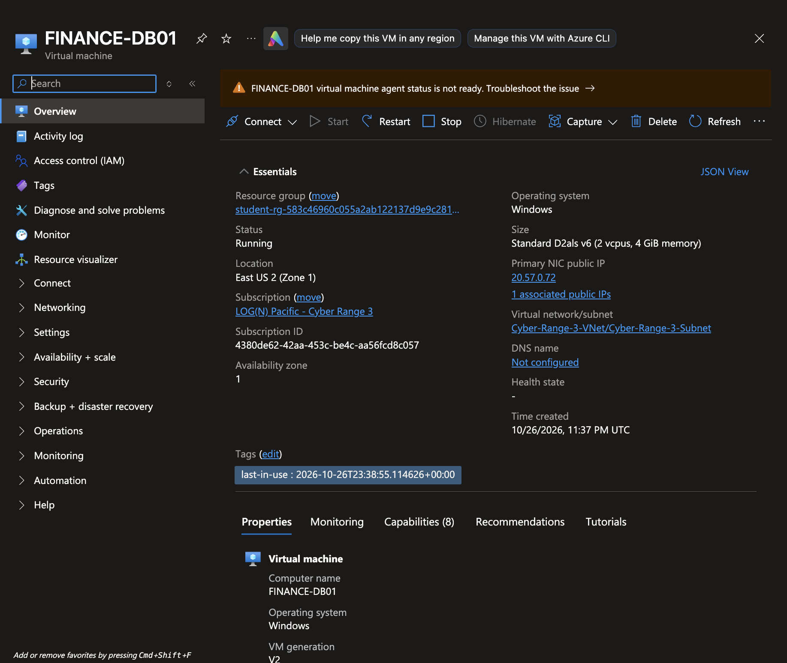
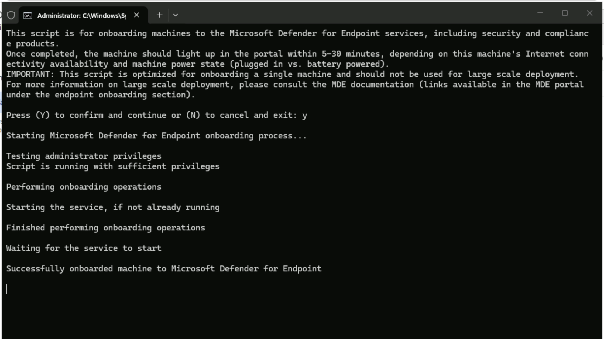
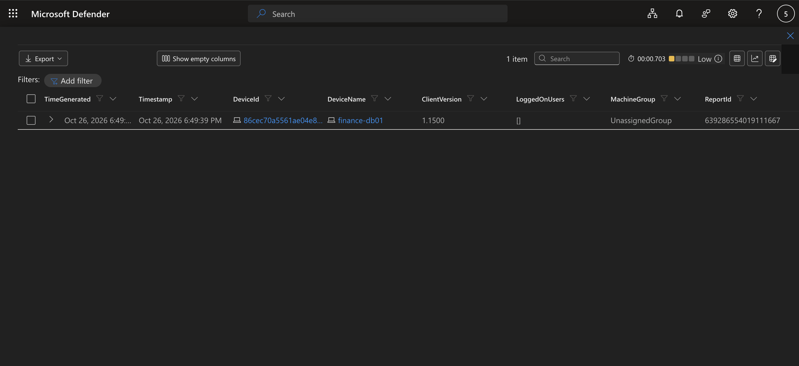

# Project Overview

This project focuses on deploying and configuring a Windows 11 honeypot in Microsoft Azure to simulate a corporate endpoint and establish a foundation for monitoring potential cyberattacks.

The virtual machine, named FINANCE-DB01, is configured to resemble a financial system within an organization. Microsoft Defender for Endpoint (MDE) is then deployed to provide visibility into authentication attempts, process execution, network connections, file activity, and registry modifications.

Using Kusto Query Language (KQL), I verify that the endpoint is successfully onboarded and reporting telemetry to Microsoft Defender. Azure Network Security Group (NSG) rules remain restrictive during setup to ensure monitoring capabilities are established before exposing the honeypot to external traffic.

This project establishes the foundation for future threat-hunting investigations, where I will analyze suspicious activity, identify attacker behavior, and investigate potential security threats within a live Azure environment.

---
### 1. Virtual Machine Deployment

I will begin by provisioning a Windows 11 virtual machine in Microsoft Azure and configuring it to resemble a legitimate corporate asset.

To make the environment appear authentic, I will assign the VM a hostname that suggests it serves an important business function. I will also configure a realistic corporate-style user account to simulate an employee or administrator within an organization.

**VM Hostname:** `FINANCE-DB01`

The hostname is intended to resemble a financial database server that could potentially contain sensitive organizational information, making it a plausible target for attackers seeking valuable business data.

During this initial deployment phase, inbound internet traffic will remain restricted through Azure Network Security Group (NSG) rules. This ensures that the environment remains protected while the necessary monitoring and logging infrastructure is configured.

**VM Configuration:**



### 2. Microsoft Defender for Endpoint Onboarding

After successfully deploying the virtual machine, I will sign in and onboard the endpoint to Microsoft Defender for Endpoint (MDE).

Microsoft Defender for Endpoint provides endpoint detection and response (EDR) capabilities that will allow me to monitor security-related activity occurring on the honeypot.

This includes visibility into:

- **Authentication Activity:** Successful and failed login attempts, including potentially unauthorized access.
- **Process Execution:** Applications, scripts, and commands executed on the system.
- **Network Connections:** Inbound and outbound communication that may indicate suspicious activity.
- **File Activity:** File creation, modification, and deletion events.
- **Registry Modifications:** Changes to Windows Registry entries that may indicate persistence or unauthorized system configuration.

Establishing this visibility before exposing the honeypot is essential for capturing a baseline of legitimate activity and identifying deviations that may indicate malicious behavior.

**Microsoft Defender Onboarding:**



### 3. Verifying Endpoint Telemetry Using KQL

Once the onboarding process is complete, I will navigate to the Microsoft Defender portal and use Kusto Query Language (KQL) to verify that the endpoint is successfully reporting telemetry.

To accomplish this, I will execute the following query against the `DeviceInfo` table:

```
DeviceInfo
| where DeviceName =~ "FINANCE-DB01"
```

**Query Breakdown:**

- `DeviceInfo`: Retrieves device inventory and endpoint information collected by Microsoft Defender for Endpoint.
- `where`: Filters the returned records based on a specified condition.
- `DeviceName`: Identifies the hostname associated with the endpoint.
- `=~`: Performs a case-insensitive string comparison to match the specified hostname.

This query searches for device records associated with `FINANCE-DB01`.

If the query successfully returns the expected endpoint, it confirms that Microsoft Defender recognizes the virtual machine and is receiving its device information.

This verification is an important prerequisite for future investigations, as the endpoint must be properly onboarded before I can reliably collect and analyze its security telemetry.

**KQL Query Results:**



### 4. Verification Results

The KQL query successfully returned the `FINANCE-DB01` endpoint, confirming that the virtual machine has been onboarded to Microsoft Defender for Endpoint.

This establishes the initial endpoint monitoring foundation required for the remaining phases of the project.

With the endpoint successfully onboarded, I can proceed with configuring additional logging sources to improve visibility into database activity and potential attacker behavior.

---
# Conclusion

With FINANCE-DB01 successfully deployed and onboarded to Microsoft Defender for Endpoint, I have established the foundation needed to monitor endpoint activity and perform security investigations within my Azure environment.

In the next project, I will focus on endpoint isolation and incident response using Microsoft Defender for Endpoint. I will configure the virtual machine to accept ICMP requests, verify network connectivity through ping tests, and then isolate the endpoint using Microsoft Defender to observe how isolation affects network communication. After confirming that isolation is successful, I will release the machine and verify that connectivity has been restored.

This exercise aligns with the NIST SP 800-61 incident response framework, particularly the Containment, Eradication, and Recovery phase described in Revision 2. Endpoint isolation demonstrates how security teams can contain a potentially compromised system to limit further malicious activity, while releasing the endpoint and verifying connectivity simulates part of the recovery process.

By completing this exercise, I will gain practical experience using Microsoft Defender's endpoint response capabilities before progressing into more advanced threat-hunting and incident investigation scenarios.
