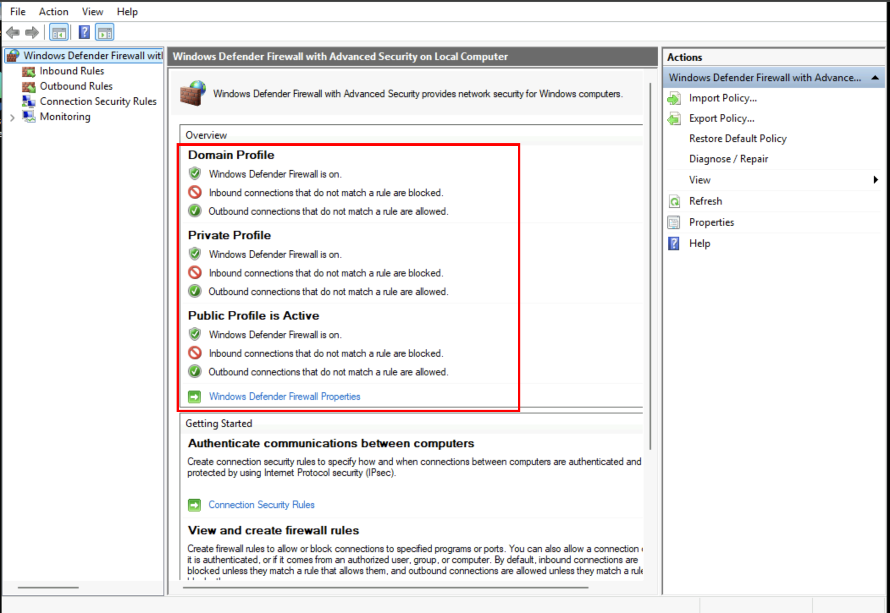
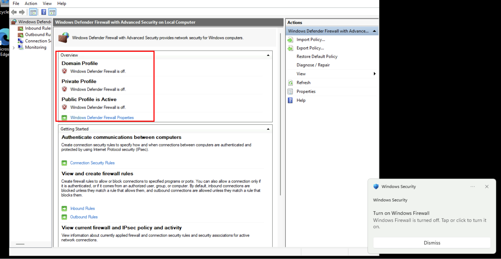
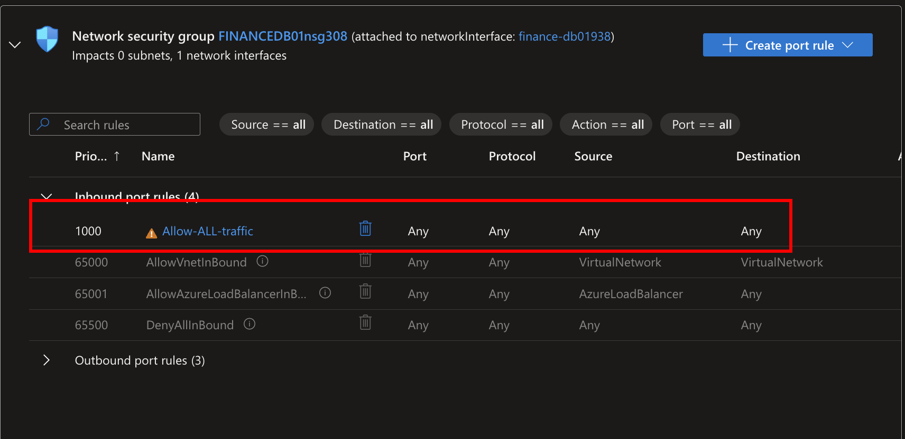
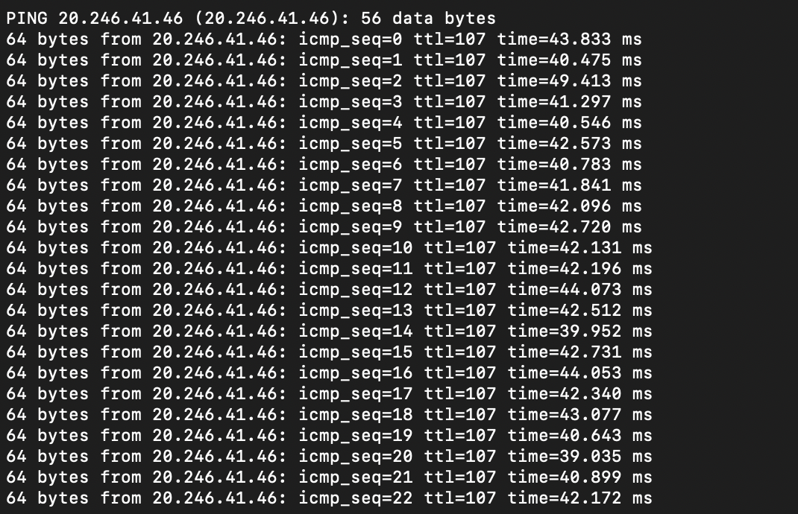
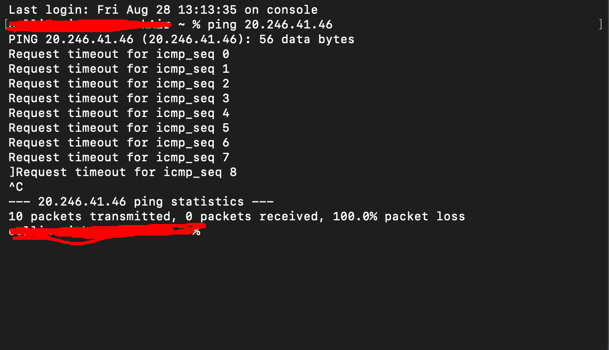
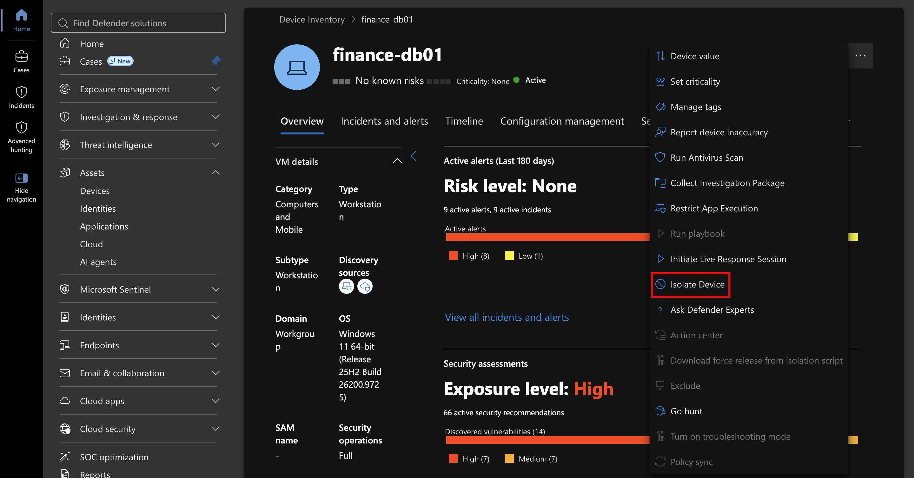
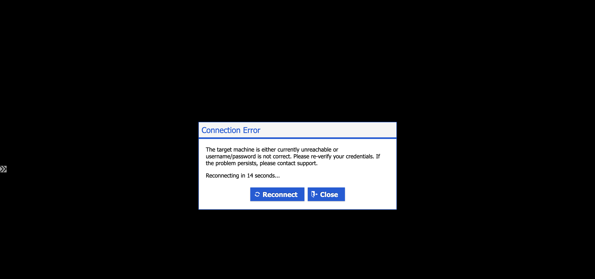
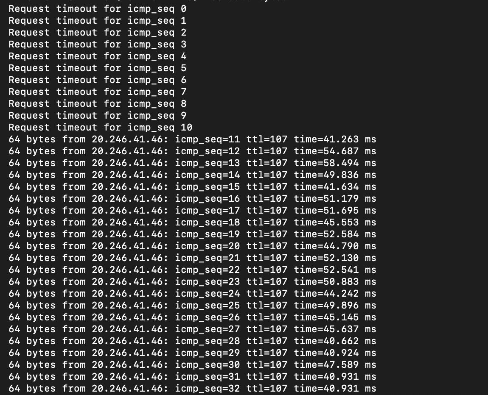

## Project Overview

In this project, I will demonstrate how Microsoft Defender for Endpoint (MDE) can be used to isolate and restore network connectivity to a Windows 11 virtual machine hosted in Microsoft Azure.

Building on my previous project, where I deployed and onboarded the `FINANCE-DB01` endpoint, I will configure the machine to accept ICMP traffic, verify network connectivity, and use Microsoft Defender's built-in endpoint isolation feature to restrict network communication.

After confirming that isolation is successful, I will release the endpoint from isolation and verify that normal network connectivity has been restored.

This exercise aligns with the incident response principles outlined in **NIST SP 800-61 Revision 2**, particularly the Containment, Eradication, and Recovery phase. Isolating an endpoint demonstrates containment, while restoring connectivity and validating normal operation demonstrates an important aspect of recovery.

The objective is to gain hands-on experience with endpoint containment and recovery procedures commonly performed by Security Operations Center (SOC) analysts during security incidents.

---

## 1. Configuring the Virtual Machine for Network Connectivity

Before testing endpoint isolation, I need to ensure that my Azure virtual machine can receive ICMP echo requests from my local computer.

By default, Windows Defender Firewall restricts certain types of inbound traffic, including ICMP echo requests, depending on the firewall configuration.

### Disabling Windows Defender Firewall

I began by reviewing the Windows Defender Firewall settings on `FINANCE-DB01`.

**Windows Defender Firewall Enabled:**

Next, I navigated to **Windows Defender Firewall Properties** and disabled the firewall across the Domain, Private, and Public profiles.

**Windows Defender Firewall Disabled:**

Disabling the firewall allows incoming ICMP requests to reach the machine without being blocked by Windows Defender Firewall.

**Security Note:** Disabling all firewall profiles is not recommended in production environments. A more secure approach would be to create a specific inbound firewall rule allowing ICMP echo requests from an authorized source. For this controlled lab, the firewall was disabled to demonstrate the effect of endpoint isolation.

### Configuring Azure Network Security Group Rules

After modifying the Windows firewall settings, I navigated to Microsoft Azure and updated the virtual machine's Network Security Group (NSG).

I created an inbound security rule allowing traffic from any source to reach the virtual machine.

**Azure NSG Configuration:**

This configuration intentionally exposes the virtual machine to inbound traffic for testing purposes.

In a production environment, allowing unrestricted inbound traffic would introduce significant security risks. This configuration is used strictly for the lab demonstration and should be removed when testing is complete.

## **2. Testing Network Connectivity Using ICMP**

With the firewall and NSG configurations updated, I began testing network connectivity between my local macOS computer and the Azure virtual machine.

To accomplish this, I used the `ping` command, which sends Internet Control Message Protocol (ICMP) echo requests to a destination IP address.

### Initial Connectivity Test

Before modifying the firewall and NSG settings, I attempted to ping the Azure virtual machine.

**Ping Results Before Configuration Changes:**

The initial test was unsuccessful because the existing network security configuration prevented the ICMP requests from receiving responses.

### Connectivity Test After Configuration Changes

After disabling Windows Defender Firewall and updating the Azure NSG, I repeated the ping test.

**Ping Results After Configuration Changes:**

This time, the virtual machine successfully responded to the ICMP echo requests.

These successful responses confirmed that network communication was functioning between my local computer and the Azure endpoint.

With connectivity established, I could now test whether Microsoft Defender for Endpoint would successfully restrict network communication when the device was isolated.

---

## **3. Isolating the Endpoint Using Microsoft Defender**

Endpoint isolation is an incident response capability that allows security analysts to restrict network communication on a potentially compromised device.

This feature is particularly useful when an endpoint is suspected of malware infection, unauthorized access, or communication with malicious infrastructure.

By isolating an endpoint, security teams can limit an attacker's ability to communicate with external systems or move laterally across the network while maintaining the management communication necessary for Microsoft Defender to monitor the device.

### Initiating Endpoint Isolation

I navigated to the Microsoft Defender portal and located the `FINANCE-DB01` endpoint.

From the device management interface, I selected the built-in **Isolate device** action.

**Microsoft Defender Endpoint Isolation:**

After initiating isolation, I allowed time for Microsoft Defender to apply the network restrictions.

### Verifying Isolation Through ICMP Testing

While the isolation process was taking place, I continued monitoring the ping requests from my Mac.

**Ping Results During Isolation:**

Once isolation was applied, the endpoint stopped responding to ICMP echo requests.

This demonstrated that Microsoft Defender had successfully restricted the network communication previously established between my local computer and the Azure virtual machine.

To further verify the isolation state, I accessed the virtual machine and observed the restrictions applied by Microsoft Defender.

**Endpoint Isolation Confirmation:**

These observations confirmed that the isolation action was successful.

### Incident Response Significance

During an actual security incident, endpoint isolation can help security analysts:

- Prevent further communication with command-and-control (C2) infrastructure.
- Restrict lateral movement between systems.
- Reduce the risk of additional malicious activity.
- Preserve access to endpoint telemetry for continued investigation.

This exercise demonstrates the **Containment** aspect of incident response, where the objective is to limit the potential impact of a security incident before further remediation takes place.

---

## 4. Releasing the Endpoint From Isolation

After confirming that endpoint isolation was functioning correctly, I proceeded with restoring network connectivity.

In a real-world incident, an endpoint should generally remain isolated until investigators have determined that the threat has been contained and appropriate remediation has been completed.

Because this project is a controlled demonstration without an active malware infection, I can safely proceed with releasing the device from isolation.

### Restoring Network Connectivity

I returned to the Microsoft Defender portal, located `FINANCE-DB01`, and selected **Release from isolation**.

After allowing time for Microsoft Defender to remove the network restrictions, I monitored the ongoing ping requests from my local computer.

**Ping Results After Releasing Isolation:**

The virtual machine began responding to ICMP echo requests again.

This confirmed that network connectivity had been restored following the removal of the isolation restrictions.

### Incident Response Significance

This step demonstrates an important aspect of the **Recovery** process described in NIST SP 800-61 Revision 2.

During recovery, security teams work to restore affected systems to normal operation after ensuring that the threat has been appropriately addressed.

In this exercise, successful ICMP responses provided a simple method of validating that network connectivity had been restored.

However, restoring connectivity alone does not establish that a compromised system is safe. A real incident would require additional validation, such as malware removal, persistence checks, and endpoint health verification.

---

## 5. Alignment With NIST SP 800-61

This project demonstrates practical incident response concepts associated with the NIST SP 800-61 Revision 2 framework.

| Incident Response Activity | Project Implementation |
| --- | --- |
| Preparation | Deployed and onboarded the Azure endpoint to Microsoft Defender |
| Containment | Isolated `FINANCE-DB01` to restrict network communication |
| Eradication | Not performed because no active malware infection was introduced |
| Recovery | Released the endpoint from isolation and verified connectivity using ICMP |

Although this project does not simulate a complete security incident, it provides practical experience with two important response activities: containment and recovery.

Understanding these procedures is essential for SOC analysts who may need to isolate compromised endpoints quickly while supporting investigations and safely restoring business operations.

---

## Conclusion

In this project, I successfully demonstrated endpoint isolation and network connectivity restoration using Microsoft Defender for Endpoint within a Microsoft Azure environment.

By configuring network access, monitoring ICMP requests, isolating the virtual machine, and restoring connectivity, I gained practical experience with endpoint response capabilities that support incident containment and recovery.

The exercise also reinforced the importance of validating security actions rather than assuming they were successful. By continuously monitoring network connectivity, I was able to observe the effects of isolation and confirm when communication was restored.

**In my next project, I will expand on these incident response capabilities by collecting an investigation package from Microsoft Defender for Endpoint and examining the forensic artifacts it contains.** This will introduce another important component of incident response: gathering endpoint evidence to support security investigations and understand potentially malicious activity.
