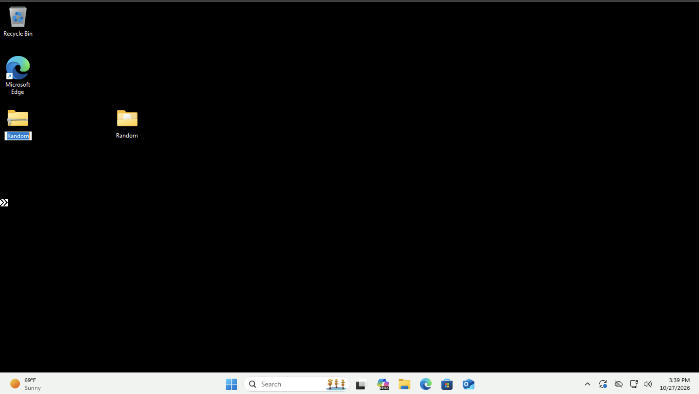
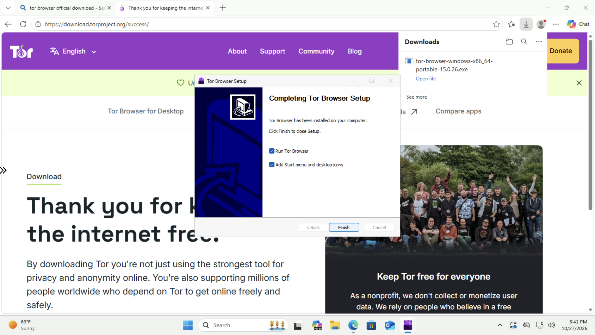
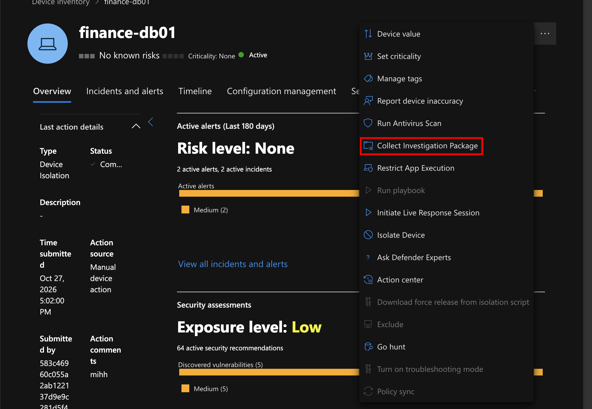
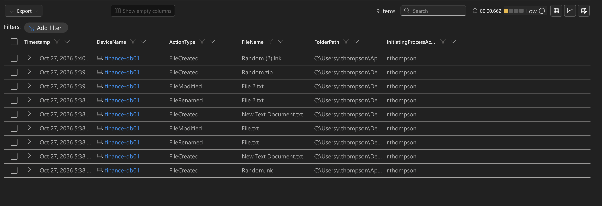
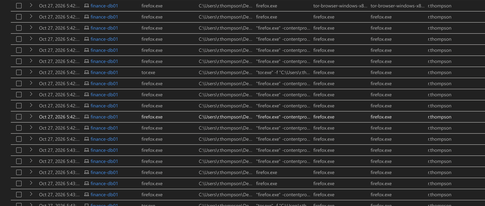
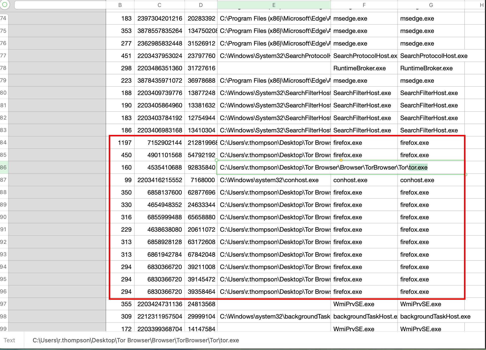

## Project Overview

In this project, I will continue working with the `FINANCE-DB01` Windows 11 virtual machine deployed in Microsoft Azure during my previous labs.

Previously, I demonstrated how Microsoft Defender for Endpoint (MDE) can isolate a potentially compromised endpoint and restore network connectivity. Now, I will focus on another important aspect of incident response: **collecting and analyzing endpoint forensic evidence**.

To simulate activity that an investigator might need to examine, I will create a folder containing text files, modify those files, compress the folder into a ZIP archive, and install and launch Tor Browser.

After generating this activity, I will collect an investigation package through Microsoft Defender for Endpoint and use Kusto Query Language (KQL) to identify the corresponding endpoint events.

The objective is to understand how security analysts can correlate endpoint telemetry with collected forensic artifacts to reconstruct user activity during an investigation.

This project also reinforces the evidence collection and analysis practices described in NIST SP 800-61.

---

## **1. Generating Endpoint Activity**

Before collecting the investigation package, I need to generate activity on the virtual machine that I can later investigate.

This will provide known events that I can search for using KQL and compare against the contents of the investigation package.

### Creating a Folder and Text Files

I began by creating a folder named `Random` on the virtual machine.

Inside this folder, I created two text files, `File` and `File2`, and modified their contents.

I also compressed the folder into a ZIP archive.

**Folder and File Creation:**



These actions provide examples of file system activity that Microsoft Defender may record, including file creation and modification events.

### Installing and Launching Tor Browser

Next, I downloaded, installed, and launched Tor Browser on the virtual machine.

**Tor Browser Installation:**



Tor Browser is a privacy-focused browser built on Mozilla Firefox technology that routes traffic through the Tor network.

Although Tor Browser is a legitimate privacy tool, its execution may be relevant during security investigations when analysts are examining potentially unauthorized software or unusual endpoint activity.

For this lab, I will use Tor Browser as a recognizable application to investigate through process execution telemetry.

---

## **2. Collecting the Microsoft Defender Investigation Package**

After generating the activity, I navigated to the Microsoft Defender portal and searched for my endpoint, `FINANCE-DB01`.

From the device page, I selected **Collect investigation package**.

**Investigation Package Collection:**



Microsoft Defender collected diagnostic and forensic information from the endpoint and made the resulting package available for download as a ZIP archive.

An investigation package can contain artifacts such as:

- Running process information
- System and service information
- Network connection details
- Autoruns and persistence-related information
- Selected system configuration and diagnostic data

The exact contents depend on the endpoint platform and the information available during collection.

Unlike a complete forensic disk image, an investigation package does not necessarily contain every file or historical action performed on the endpoint.

### Investigation Objectives

My objective is to identify evidence of two activities:

1. The creation and modification of the `Random` folder and its text files.
2. The installation and execution of Tor Browser.

I will first investigate these activities using KQL and then examine the collected ZIP archive to determine which artifacts are available.

---

## 3. Investigating File Activity Using KQL

To investigate the folder and text files I created, I used the `DeviceFileEvents` table in Microsoft Defender Advanced Hunting.

This table contains endpoint telemetry associated with file-related activity, including file creation, modification, deletion, and other supported file operations.

### KQL Query

```jsx
DeviceFileEvents
| where DeviceName =~ "FINANCE-DB01"
| where FolderPath contains "random"
    or FileName in~ ("File", "File2")
| project Timestamp, DeviceName, ActionType,
          FileName, FolderPath, InitiatingProcessAccountName
| order by Timestamp desc
```

### Query Breakdown

- `DeviceFileEvents`: Searches file-related activity recorded by Microsoft Defender.
- `DeviceName =~ "FINANCE-DB01"`: Filters events associated with my virtual machine using a case-insensitive comparison.
- `FolderPath contains "random"`: Searches for file events involving paths containing the word `random`.
- `FileName in~ ("File", "File2")`: Searches for the specified filenames using case-insensitive matching.
- `project`: Displays only the fields relevant to the investigation.
- `order by Timestamp desc`: Sorts the results from newest to oldest.

### Investigation Results

**KQL File Activity Results:**



The query returned events associated with the folder and files I created.

Through the results, I was able to identify activity involving the `Random` directory, the creation and modification of the text files, and the ZIP archive generated from the folder.

These events demonstrate how Microsoft Defender records file system activity and how KQL can be used to reconstruct changes made to an endpoint.

In a real-world investigation, similar queries could help analysts identify suspicious file creation, malware staging directories, unauthorized modifications, or potentially malicious archives.

---

## 4. Investigating Tor Browser Activity Using KQL

Next, I investigated the activity associated with Tor Browser.

For this portion of the investigation, I used the `DeviceProcessEvents` table.

This table records process execution activity and provides information such as executable names, process paths, command-line arguments, and parent processes.

### KQL Query

```jsx
DeviceProcessEvents
| where DeviceName contains "finance"
| where FileName in~ ("tor.exe", "firefox.exe")
| where FolderPath contains "Tor Browser"
    or ProcessCommandLine contains "Tor Browser"
| project Timestamp, DeviceName, FileName, FolderPath,
          ProcessCommandLine, InitiatingProcessFileName,
          InitiatingProcessCommandLine, AccountName
| order by Timestamp asc
```

### Query Breakdown

- `DeviceProcessEvents`: Searches process execution telemetry collected from monitored endpoints.
- `DeviceName contains "finance"`: Filters events associated with devices whose names contain `finance`.
- `FileName in~ ("tor.exe", "firefox.exe")`: Searches for executable names associated with Tor Browser.
- `FolderPath contains "Tor Browser"`: Identifies processes executing from paths associated with Tor Browser.
- `ProcessCommandLine contains "Tor Browser"`: Searches for process command lines referencing Tor Browser.
- `InitiatingProcessFileName`: Identifies the process responsible for launching another process.
- `InitiatingProcessCommandLine`: Displays the command line associated with the initiating process.
- `order by Timestamp asc`: Displays events chronologically to help reconstruct the sequence of execution.

### Investigation Results

**Tor Browser Process Activity:**



The query returned process events associated with Tor Browser, allowing me to examine executable paths, process execution details, and related activity.

One important observation was that Tor Browser uses Firefox-based components, explaining why `firefox.exe` appeared in the process telemetry.

The results provided visibility into Tor Browser execution and related process activity on the endpoint.

However, process execution logs alone do not necessarily reveal every website visited or every file downloaded through the browser. Additional network, file, or browser artifacts would be needed to establish those details.

This investigation demonstrates how SOC analysts can use process telemetry to identify applications executed on an endpoint and investigate potentially suspicious software.

---

## 5. Examining the Investigation Package

After completing the KQL searches, I examined the investigation package downloaded from Microsoft Defender.

My goal was to determine whether the evidence identified through Advanced Hunting could also be located within the collected forensic artifacts.

### Identifying Tor Browser Process Artifacts

I opened the investigation package and navigated to the `Processes` directory.

Using the search functionality, I located process information associated with Tor Browser.

**Tor Browser Evidence in Investigation Package:**



The collected process information provided additional evidence that Tor Browser had been executed on the endpoint.

This demonstrates how investigation packages can supplement KQL queries by providing diagnostic information collected directly from the device.

### Searching for the Created Folder and Text Files

Next, I searched the investigation package for the `Random` folder and the text files created earlier.

Although the file activity was visible through KQL, I was unable to locate the corresponding folder and text files within the downloaded investigation package.

This is an important distinction between **endpoint telemetry and forensic artifact collection**.

Microsoft Defender Advanced Hunting provides historical event records for supported activities, while an investigation package collects a defined set of endpoint diagnostic artifacts.

Therefore, an event appearing in `DeviceFileEvents` does not guarantee that the associated file or its contents will be included in an investigation package.

In this case, KQL provided the evidence needed to reconstruct the file activity, even though the files themselves were not located in the collected archive.

---

## 6. Connection to NIST SP 800-61

This project supports the incident analysis and evidence collection principles described in NIST SP 800-61 Revision 2.

| Incident Response Activity | Project Implementation |
| --- | --- |
| Preparation | Configured the Azure endpoint and onboarded it to Microsoft Defender |
| Detection and Analysis | Used KQL to investigate file and process execution activity |
| Evidence Collection | Collected and examined a Microsoft Defender investigation package |
| Documentation | Identified and documented relevant endpoint artifacts and observed activity |

The project primarily demonstrates **Detection and Analysis**, since the objective is to identify, examine, and correlate evidence rather than contain an active security threat.

In real incidents, these techniques can help analysts understand what occurred on an endpoint, identify potentially malicious activity, and determine what additional investigation or response actions are necessary.

---

## Conclusion

In this project, I successfully used Microsoft Defender for Endpoint and Kusto Query Language to investigate file system changes and process execution activity on my Azure-hosted Windows 11 virtual machine.

By creating test files, modifying their contents, compressing them into an archive, and executing Tor Browser, I generated endpoint activity that could be investigated using Microsoft Defender Advanced Hunting.

I then collected an investigation package and examined its contents to identify supporting forensic evidence.

One of the most important findings was the difference between historical endpoint telemetry and collected forensic artifacts. Although KQL allowed me to identify the file-related events, the investigation package did not contain the corresponding files in the locations I examined.

This exercise strengthened my understanding of endpoint evidence collection, process analysis, file activity investigation, and the role of Microsoft Defender in supporting SOC investigations.

It also demonstrated why security analysts should use multiple sources of evidence when reconstructing activity on a potentially compromised endpoint.
